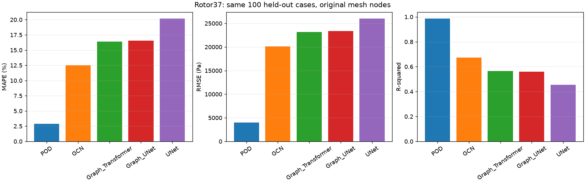
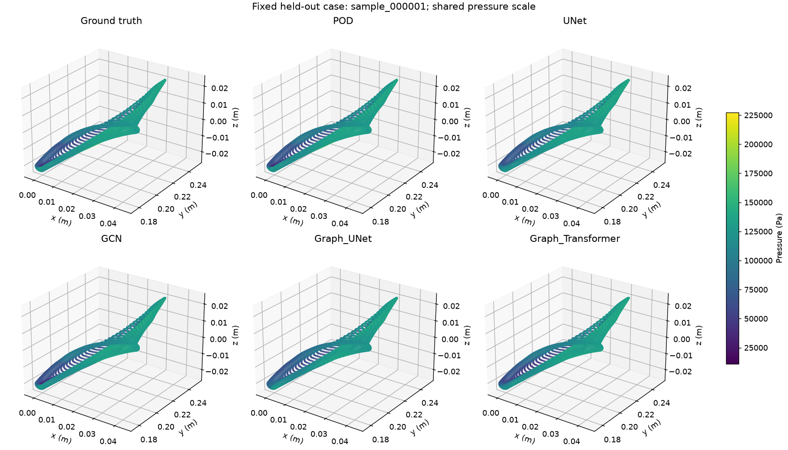
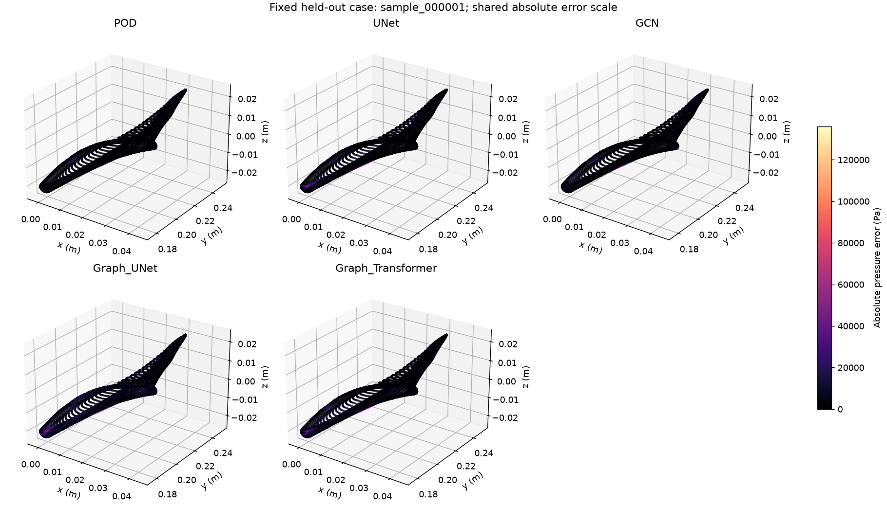
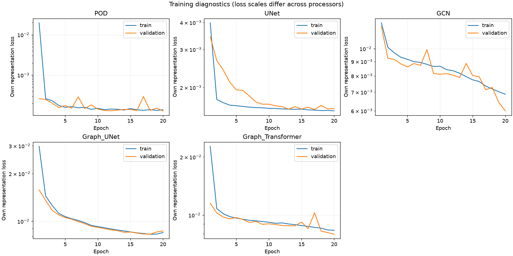

# Rotor37 五模型预测效果对比

所有模型从头训练 20 轮（每轮 800 个工况、batch=1、共 16000 optimizer steps），seed=42，学习率 1e-4，scale=small。
使用相同的 800/100/100 划分，仅由验证集选择各自最佳检查点。所有模型都在独立测试集的原始 2,977,300 个节点上重新计算误差。
POD 模态只拟合 800 个训练样本；UNet 最长轴网格分辨率为 50（实际网格形状见检查点），曲面数据采用半体素对角线宽度的表面带掩码，图模型保留完整网格。

| 模型 | MAPE (%) ↓ | RMSE (Pa) ↓ | MAE (Pa) ↓ | R² ↑ | 最佳轮数 | 参数量 | 训练耗时 (s) |
|---|---:|---:|---:|---:|---:|---:|---:|
| POD | 2.876 | 3980.6 | 2547.7 | 0.9872 | 20 | 296,737 | 55.4 |
| GCN | 12.511 | 20111.0 | 10042.9 | 0.6740 | 20 | 213,505 | 1121.9 |
| Graph_Transformer | 16.414 | 23201.8 | 13199.6 | 0.5661 | 20 | 51,521 | 313.6 |
| Graph_UNet | 16.571 | 23373.7 | 13941.4 | 0.5596 | 18 | 21,441 | 516.0 |
| UNet | 20.201 | 26040.9 | 14742.4 | 0.4534 | 17 | 22,585,537 | 343.2 |

本轮最低 RMSE 为 POD，比训练集平均场低 28.7%。

训练集平均压力场参考（不使用 Omega/P）：MAPE 3.957%，RMSE 5579.3 Pa。这用于判断是否学到了超出固定平均场的工况变化。

在该预算下，优于训练集平均场 RMSE 的模型：POD。

## 解读与限制

按 RMSE 排序；训练损失空间不同，不能直接用各模型训练 loss 排名。表中耗时为模型训练循环耗时，不含预处理和独立测试；三张同型号 GPU 并行运行，系统负载会影响耗时。完整流水线耗时保存在 CSV/JSON。
数据同一节点拓扑，但测试样本坐标存在变化（相对第一个测试样本最大坐标差 0.00307576 m）。本轮采用参考几何训练设定，POD 按共同节点编号建模，图模型使用参考几何特征，UNet 在参考体素网格上学习并按各测试样本坐标回采样；所有输出均保留该样本真实几何。未将独立几何参数作为工况输入，不能据此声称具有新几何泛化能力。
这是单个种子、相同 epoch 预算下的首轮实验，未做多种子统计或逐模型超参数搜索；不能据此认定某种架构普遍更优。每个模型的 small 参数量不同，相同样本遍历次数不等于相同计算成本。
UNet 的网格化与插值误差、POD 的降维重建误差均计入统一原始节点指标。MAPE 阈值统一采用训练集绝对压力 p95 的 0.001 倍，避免不同处理器阈值造成偏差。
压力场图选择固定测试样本 sample_000001，仅为展示，不按模型效果挑选；散点图为清晰展示做固定步长抽稀，指标使用全部节点。

原始结果：metrics.csv、per_sample_metrics.csv、comparison.json；模型及完整日志路径见 comparison.json 中 run_directory；原曲面处理有误的 UNet 历史运行已排除，最终使用 runs/comparison20_surface/UNet。
