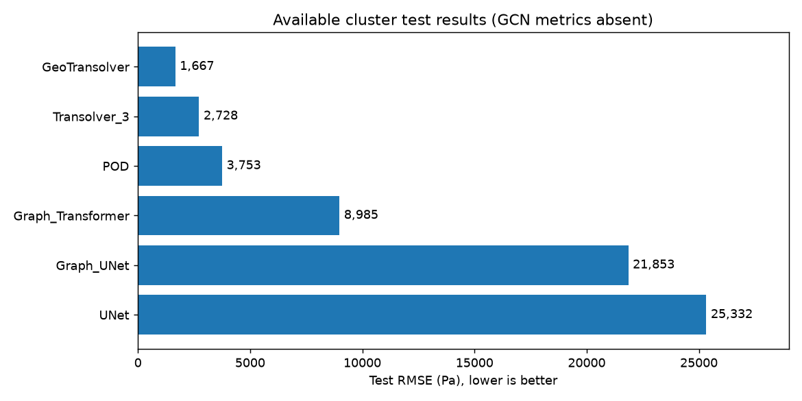
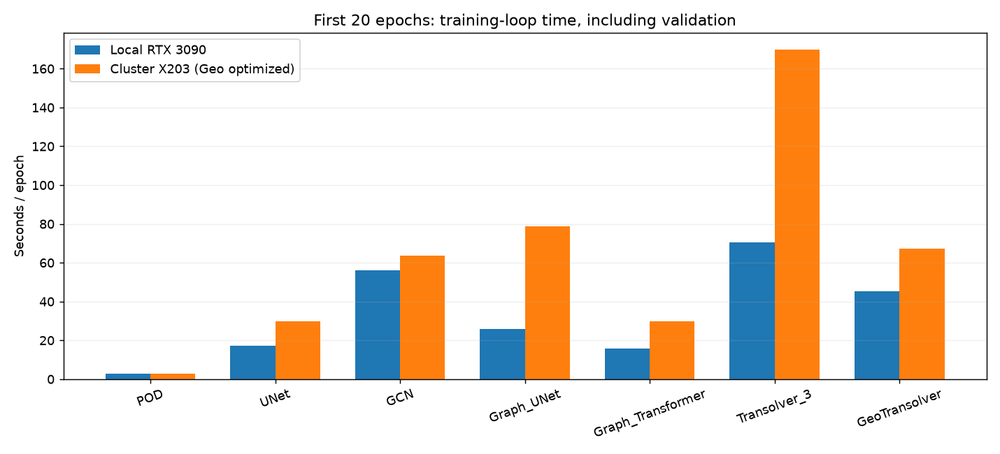
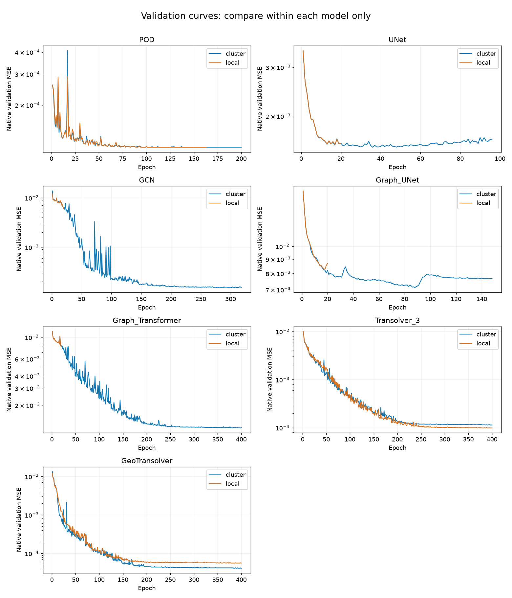

# 沐曦 X203 七模型训练与本机对比（2026-11-12）

来源：/data/hesc/runs.zip，两个嵌套日志包。所有结论基于上传日志，不查询实时Slurm状态，未使用本机GPU。

## 主要结论

1. 原始七任务中5个完成训练和测试；GCN在第319轮中途被取消，旧Geo在第2轮中途被取消。优化Geo另外完成400轮及测试流程，合计6个有效模型完成。
2. 已有6个统一测试指标中，GeoTransolver最佳（RMSE 1666.6 Pa），Transolver_3第二（2727.6 Pa），POD第三（3752.6 Pa）。更新后的Geo统一测试指标已补齐；GCN未测试，七模型精度排名仍缺GCN。
3. 前20轮同预算：POD与本机相当，其余集群训练耗时为本机1.14–3.05倍；这是实际软件栈和负载下的结果，不能单独归因GPU硬件。
4. 优化Geo完成400轮训练循环7小时15分；首次邻居预计算73分42秒，训练流程及测试总计7小时33分（该task计时从预计算后开始）。首次合计约8小时47分。
5. 自动生成的timing_comparison.csv有本机续训重启计时错误：Transolver_3的20→200，以及Geo的200→400，日志末尾时长都只覆盖最后一次启动。本文用同模型验证周期中位耗时辅助比较，避免错误速度倍数。

## 数据和口径核验

七模型及优化Geo的900样本pool与本机train+valid样本集合相同，100个test样本与本机报告一致，seed均为42。包内data_split.json只记录pool/test，缺少最终effective_train/effective_valid表，因此这次独立核验到900/100层级，不能声称已逐项验证最终800/100内部成员。训练日志/config记录每轮800训练、100验证，batch=1，前20轮lr=1e-4；后续plateau factor=.5、patience=8、threshold=.005、cooldown=2、min_lr=1e-6，early-stop patience=60。

训练循环时间包含加载、前后向、验证及保存，排除前置预处理；pipeline_train_seconds是训练子进程总耗时；task_seconds还含环境检查及测试，但优化Geo的task_seconds不含父脚本先执行的邻居预计算。Slurm排队时间不在上述计时内。

原始节点指标使用100个测试样本、共2,977,300节点。各模型原生loss空间不同，不能按val_loss横向排名。训练预算和早停轮数不同，最终表表示当前协议下结果，并非相同计算量的架构比较。

## 七模型进度和最终测试

|模型|状态/完成轮数|测试最佳轮数|RMSE(Pa)|MAPE(%)|R²|训练循环累计|
|---|---|---:|---:|---:|---:|---|
|POD|完成200|191|3752.6|2.694|0.988649|10分24秒|
|UNet|早停96|36|25331.8|18.998|0.482723|47分38秒|
|GCN|第319轮中途取消|—|—|—|—|未完阶段无完整计时|
|Graph_UNet|早停148|88|21853.2|15.437|0.615037|2小时48分12秒|
|Graph_Transformer|完成400|399|8984.6|6.166|0.934929|3小时22分44秒|
|Transolver_3|完成400|397|2727.6|2.073|0.994003|14小时16分43秒|
|GeoTransolver|优化版完成400|394|1666.6|1.221|0.997761|7小时15分7秒|

UNet在第36轮取得最佳验证检查点，之后60轮无改善而于96轮早停；Graph_UNet最佳88轮、148轮早停，属于预期策略。POD训练到200轮但未触发续400，测试检查点来自191轮。训练日志损失仅保留6位小数，多个轮次四舍五入相同；不能用日志首个最小值替代检查点内的精确最佳轮次。

GCN日志最后global_step=255038/320000，即第319轮batch638；已完成验证到318轮，最后val_loss=.000153，未见发散。Slurm明确记录2026-11-11 15:48:33 CANCELLED，不能把status仍为training_400当作任务还在运行，也不能据此推断取消原因。旧Geo在1173步、约1.47轮取消（14:18:06），不并入优化版训练时长或精度。

已结束模型无训练Traceback、ERROR及NaN/Inf；stderr中的厂商算子/上下文警告未阻止完成。training_history.csv为空表头是原导出器未记录progress callback造成，本文直接从canonical train_*_console.log重建曲线。

当前长训相对本机20轮报告的RMSE变化仅用于说明追加预算后的变化（混有设备差异）：
- POD：降低5.7%。
- UNet：降低2.7%。
- Graph_UNet：降低6.5%。
- Graph_Transformer：降低61.3%。
- Transolver_3：降低80.4%。

Graph_Transformer长训改善明显，但最终8984.6 Pa仍高于POD；UNet和Graph_UNet长训提升有限。Transolver_3相对本次长训POD降低RMSE约27.3%。Geo补齐统一测试后，RMSE较长训POD降低55.6%，较Transolver_3降低38.9%，为已评估六模型最佳。

## 集群与本机：相同20轮预算

|模型|本机20轮|集群20轮|集群/本机耗时|
|---|---:|---:|---:|
|POD|0分55秒|0分54秒|0.98×|
|UNet|5分43秒|9分53秒|1.73×|
|GCN|18分42秒|21分14秒|1.14×|
|Graph_UNet|8分36秒|26分16秒|3.05×|
|Graph_Transformer|5分14秒|9分53秒|1.89×|
|Transolver_3|23分32秒|56分38秒|2.41×|
|GeoTransolver|15分3秒|22分27秒|1.49×|

Geo使用优化版kdtree+缓存，20轮训练时间不含首次预计算。表中均为完整20轮训练循环计时；不能拿最佳检查点轮数当作实际训练轮数。Graph_UNet前20轮均值78.81秒/轮，但其验证周期中位63秒，说明启动/首轮等开销会拉高平均值，不能把78.81当作长期稳态。

## 本机长训可比项

只有POD、Transolver_3、GeoTransolver有本机长训基线，其他4个模型只有本机20轮记录。

|模型|阶段|集群验证周期中位秒/轮|本机中位秒/轮|集群/本机|
|---|---|---:|---:|---:|
|POD|到200|3.0|3.0|1.00×|
|Transolver_3|到200|118.0|72.0|1.64×|
|Transolver_3|到400|116.0|70.0|1.66×|
|GeoTransolver|到200|64.0|46.0|1.39×|
|GeoTransolver|到400|62.0|46.0|1.35×|

周期中位数按连续验证记录的时间差/新增epoch计算，包含周期验证，弱化单次重启或保存的影响；秒级日志对POD短周期分辨率有限。Transolver_3前20轮约169.88秒/轮，而最后200轮均值117.73秒/轮，运行期间负载/执行条件有变化，不能只用首20轮预测整段长训。

本机日志重启核验：Transolver_3到200阶段在11:18:26和14:55:51两次启动，末尾784.49秒只对应第二段；两段首个训练步骤到末个验证时间跨度合计约12873秒，而不是784秒。Geo到400阶段13:56:46和14:55:51两次启动，末尾6635.44秒仅对应后段，两段训练记录跨度合计约9222秒。跨段重放步骤和暂停不属于同一种成本，本文不把这些跨度伪装成精确GPU有效时间。

精度方面，本机长训POD在163轮早停（最佳103轮），集群完成200轮：测试RMSE 3751.8→3752.6 Pa，仅+0.021%，基本一致。Transolver_3均400轮：2560.6→2727.6 Pa，集群高6.52%，MAPE 1.963%→2.073%，性能仍优于POD，但不是数值复现。本次为单seed且软件栈不同，无法判定该差异是否统计显著或由何种算子导致。Geo均400轮，本机RMSE1900.9 Pa，集群1666.6 Pa，集群低12.32%；MAPE从1.356%降至1.221%，最佳检查点为394轮（315200步）。这是单次训练结果差异，不能证明平台或查询优化必然提升精度。

## Geo优化专项

远端geo_opt_verify_1450.out明确ALL CHECKS PASSED，检查两个真实完整样本、两个半径的全部节点索引，以及同权重模型输出/参数梯度。完整网格单样本前后向对照：旧Torch查询11.7024秒、kdtree缓存0.06793秒，热缓存局部对照约172倍；这不是端到端长训加速比，也不验证Warp原版与移植版逐位相同。优化与旧Geo首轮train_loss=.011922、val_loss=.013349完全一致到日志精度，支持缓存未改变旧移植路径的该轮行为。

预计算统计：900个样本，4422.46秒（73分42秒），平均4.91秒/样本；两个半径各898次树构建和2次磁盘命中，合计1796次冷构建。radius .05/K8：14373条歧义查询、12118块旧Torch回退；radius .25/K32：249505条歧义查询、70416块回退。回退按整块256个查询执行，即使歧义行比例较低，也可能覆盖许多查询块，这是首次预计算仍耗时的直接证据。未记录每步CPU/GPU分项时间，因此不能把总耗时精确归到某端。

优化版400轮训练循环26106.90秒（7小时15分7秒）；训练任务计时27172.89秒（7小时32分53秒，含预处理/评估，不含父脚本预计算）。加首次预计算约31595.35秒（8小时46分35秒）。缓存已经存在的后续训练可以复用这部分约74分钟的一次性工作，但训练中缺失或坐标变化的缓存仍需生成。测试100样本之前未预计算，因此647.52秒测试流程可能含新邻居缓存生成；缺少细分计时，不能称为纯推理速度。

缓存源码SHA在geo_query_backend.json中记录，并与本地补丁一致；不重新安装PhysicsNeMo或Warp。训练过程无逐步hit统计，900样本预计算完成和实测速度支持缓存发挥作用，但不能编造训练缓存命中率为100%。

Geo最后train_loss=.000037、val_loss=.000041，曲线整体稳定；本机最佳验证loss约.00005565。补齐的统一节点测试RMSE为1666.6 Pa，确认本次测试结果也优于本机该次运行；仍需多seed/独立盲测判断可重复性。

## 下一步和缺失项

更新：2026-11-12用户补传两份Geo汇总文件，CSV与JSON中指标一致，scoring_error已清除，全部2,977,300个节点均有有效MAPE。Geo训练和测试已完整闭环。此前空CSV与No module named numpy为评分环境错误，现已解决。

1. GCN仍缺独立测试结果：可评估取消前保存的最佳检查点，或续训至400后再评估，不必从头训练。
2. 已结束六模型无需重新训练/预测。Geo的metrics与comparison已附在本报告目录。
3. Geo和Transolver_3的同一测试集已在此前实验中查看，当前单seed排名不是新增盲测或统计显著性证据。
4. 此次只做离线文件分析和CPU绘图，未运行本机GPU、模型训练或推理。

## 输出文件

- model_summary.csv：七模型状态、测试结果与时长（GCN累计只覆盖已结束阶段，不能当完整训练总时长）。
- stage_timing.csv：各阶段新增轮数、循环时间、同预算比值及中位周期。
- curves.csv / *_cluster_history.csv：从日志重建的训练/验证曲线。
- split_audit.csv：本机与集群样本集合核验。
- analysis.json：机器可读汇总与源zip SHA256。
- analyze.py / plots.py：分析与绘图脚本（原始提取目录见脚本路径常量）。

