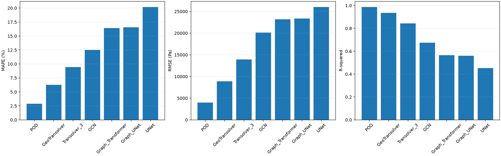
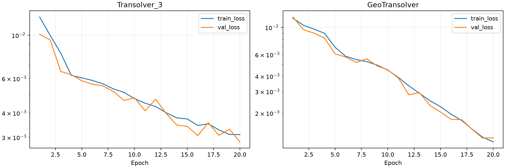
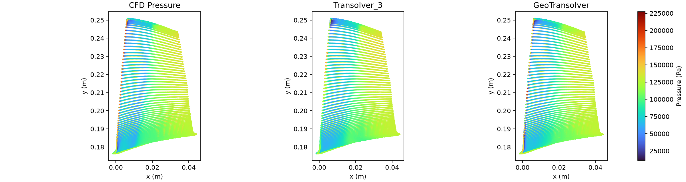

# Rotor37 七模型比较

新增模型均使用官方实现：Transolver-3 固定源码提交，GeoTransolver 使用 PhysicsNemo 2.0.0。出处与依赖见 ../../docs/transolver_rotor37.md。

相同 800/100/100 划分，seed=42、batch=1、学习率 1e-4；20 epoch、16000 次更新。按验证损失选择检查点；独立测试 100 个工况，共 2,977,300 个原始节点。旧五模型数值沿用已审核报告，新两模型重新读取原始 VTU 计算。

| 模型 | MAPE (%) | RMSE (Pa) | R² | 最佳 epoch | 参数量 | 训练秒数 |
|---|---:|---:|---:|---:|---:|---:|
| POD | 2.876 | 3980.6 | 0.9872 | 20 | 296,737 | 55.4 |
| GeoTransolver | 6.265 | 8906.1 | 0.9361 | 19 | 234,184 | 903.3 |
| Transolver_3 | 9.453 | 13934.1 | 0.8435 | 20 | 101,165 | 1411.9 |
| GCN | 12.511 | 20111.0 | 0.6740 | 20 | 213,505 | 1121.9 |
| Graph_Transformer | 16.414 | 23201.8 | 0.5661 | 20 | 51,521 | 313.6 |
| Graph_UNet | 16.571 | 23373.7 | 0.5596 | 18 | 21,441 | 516.0 |
| UNet | 20.201 | 26040.9 | 0.4534 | 17 | 22,585,537 | 343.2 |

训练集平均场基线：MAPE 3.957%，RMSE 5579.3 Pa。

Transolver_3 的测试 RMSE 比平均场高 149.7%；验证损失从第 15 轮 0.0034156 变为第 20 轮 0.00284387。 GeoTransolver 的测试 RMSE 比平均场高 59.6%；验证损失从第 15 轮 0.0020424 变为第 20 轮 0.00125994。

输入为参考网格坐标与 Omega、P 两个工况量，输出为全体网格节点的 Pressure；本数据实验未训练 u、v、w、T。GeoTransolver 将坐标提供给几何/空间分支，工况作为全局上下文。Transolver-3 使用官方全局物理切片与分块实现。

本轮沿用旧五模型的参考几何协议。各源网格坐标虽有变化，未作为逐样本变化的几何输入；因此这是 Rotor37 工况代理基准，不能证明变叶型、变角度或变冷却孔泛化。所有测试预测均验证与原始源网格坐标、连接关系一致。

同 epoch 不等于同计算量；small 配置参数量不同。这是单种子预算内比较，不能证明普遍架构优劣或已经收敛。MAPE 阈值统一由训练集压力尺度确定。训练耗时不含预处理和独立测试。

审计及数值：comparison.json、metrics.csv、per_sample_metrics_new_models.csv。新增模型的完整测试预测另存 *_predictions.npz，按 sample_names 对齐原始数据；检查点和训练日志位于 runs/transolver_comparison20。
