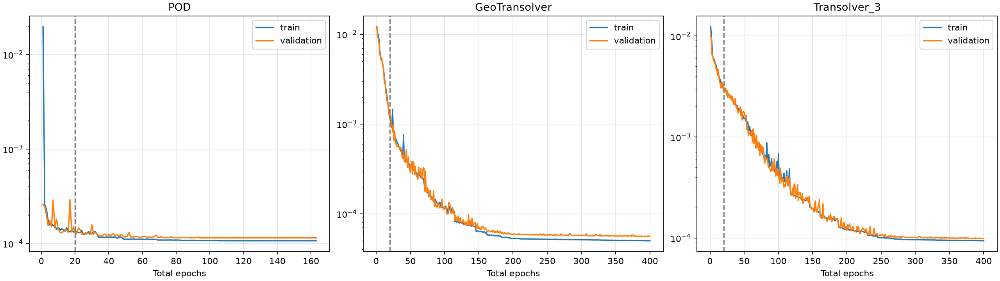

# Rotor37 长训练结果

沿用 800/100/100 划分，从原 20 轮检查点恢复权重、Adam 状态和随机数状态。仅用验证损失调度学习率、早停及选择检查点；最终一次测试 100 个历史保留工况。

| 模型 | 已完成轮数 | 最佳轮数 | MAPE (%) | RMSE (Pa) | R² |
|---|---:|---:|---:|---:|---:|
| POD（原 20 轮） | 20 | 20 | 2.876 | 3980.6 | 0.9872 |
| GeoTransolver（长训练） | 400 | 400 | 1.356 | 1900.9 | 0.9971 |
| Transolver_3（长训练） | 400 | 399 | 1.963 | 2560.6 | 0.9947 |
| POD（长训练） | 163 | 103 | 2.694 | 3751.8 | 0.9887 |

GeoTransolver：相对长训练 POD 的 RMSE 变化为降低 49.3%（负值表示更差）；按工况配对 bootstrap 的 RMSE 比值 95% 区间 [0.485, 0.529]。预定显著提升目标达到。

Transolver_3：相对长训练 POD 的 RMSE 变化为降低 31.8%（负值表示更差）；按工况配对 bootstrap 的 RMSE 比值 95% 区间 [0.657, 0.709]。预定显著提升目标达到。

目标预先定义为：RMSE 比原 POD 至少低 20%，且相对长训练 POD 的工况配对 95% 置信区间上界不超过 0.8。该区间反映测试工况抽样不确定性，不代表多随机种子训练不确定性。

本轮是长训练与原预算的比较，不是相同训练预算的架构排名。仍为参考几何到节点压力预测，不能据此推断新叶型/新冷却孔泛化。历史测试集此前已查看，本轮不用于调参，但仍需新增盲测数据验证最终结论。

完整指标、检查点哈希及配置见 comparison.json；逐工况指标见 per_sample_metrics.csv；完整节点预测见 *_predictions.npz。
